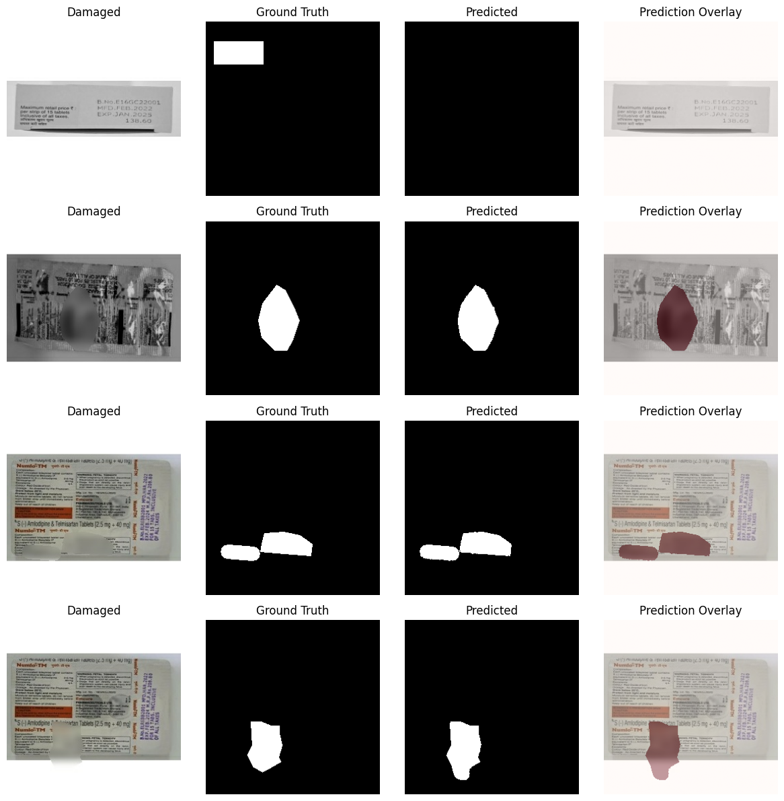

# Lightweight Diffusion-Based Recovery of Missing Pharmacy Label Information

**IE643 Deep Learning, course project — Team Maverick**

Medication labels get torn, cut, painted over or blurred during handling, scanning and delivery. This project recovers
**only the unreadable region** of a pharmacy label and leaves the visible information untouched:

1. a **U-Net** finds the damaged region (binary mask);
2. a **conditional diffusion model** reconstructs the pixels inside that mask;
3. **OCR guidance** (TrOCR / EasyOCR) makes the restored text more readable;
4. a **Gradio interface** runs the full pipeline on a single image or a batch.

```
 damaged label ──► U-Net detector ──► damage mask
        │                                   │
        └──────────────► conditional diffusion (DDIM, 25 steps, 4 samples) ──► OCR re-ranking (TrOCR)
                                                                                     │
                                         LAB colour harmonisation ◄──────────────────┘
                                                     │
                                            recovered label
```

At inference the model receives **only the damaged image**. The mask comes from the U-Net. Ground-truth masks are used
only for training and evaluation.

## Highlights

- **Accurate damage localisation:** the U-Net reaches **Dice 0.951 / IoU 0.914** on unseen labels.
- **High-fidelity reconstruction:** **27.77 dB masked PSNR**, **94.5 % pixel accuracy** and colour error **ΔE 2.98** inside the damaged region.
  That is +4.9 dB over the damaged input, +6.8 dB over OpenCV inpainting, and **+17.2 dB over our first diffusion model**.
- **Readable text:** OCR guidance **more than doubles word accuracy** on damaged text lines (9.9 % → **20.7 %**),
  cuts line character error rate from 58.6 % to **49.8 %**, and restores **4× more broken text lines** than classical inpainting.
- **End-to-end interactive demo:** one Gradio app runs detection, reconstruction and evaluation on a single image or a batch.
- **Rigorous evaluation:** leakage-safe splits by source label, unseen test labels, and two independent OCR engines for training and scoring.

---

## Repository structure

```
Notebooks/
  01_dataset_generation.ipynb               source data -> clean crops -> synthetic damage (416x416)
  02_unet_baseline.ipynb                    U-Net damage-mask detection, group-safe split
  03_diffusion_reconstruction_evaluation.ipynb   conditional diffusion model (v2), training + test evaluation
  04_diffusion_training_resume.ipynb        v2 training resumed to epoch 19 + test evaluation
  05_ocr_finetuning_v3.ipynb                OCR pre-pass + fine-tuning with an OCR text loss -> v3
  06_ocr_test_evaluation_v3.ipynb           text-accuracy test evaluation: v2 vs v3, with/without OCR re-ranking
  07_ocr_finetuning_v4_continued.ipynb      continued OCR fine-tuning (stronger, text-focused) -> v4
  08_inference_v2_v3_v4.ipynb               inference with v2/v3/v4 on 30 test labels (figures, PNGs, metrics)
Inference/
  ie643_demo.py                             Gradio demo: U-Net detection + diffusion reconstruction
  IE643_launch_interface.ipynb              launches the demo in Google Colab
  readme.md                                 demo setup and troubleshooting
results/
  unet_results/                             U-Net metrics and qualitative mask predictions
```

All notebooks are saved **with outputs** (logs, tables, figures). Model weights and the dataset are not in the
repository because of their size.

---

## 1. Dataset (`01_dataset_generation.ipynb`)

- **Source:** the Roboflow *Emcure* pharmaceutical-package dataset (v7, CC BY 4.0), with 7,709 RGB images at 416 × 416.
- **Clean labels:** the complete package is detected and cropped automatically, giving **7,000 clean label images**.
- **Synthetic damage:** each clean image gets several damaged versions with an exact binary mask.
  Masks are rectangles, irregular polygons and brush strokes, covering 1–24 % of the image (mean 7.3 %).

| damage type | samples |
|---|---|
| combined | 4,248 |
| tear | 4,240 |
| blur | 4,221 |
| cut | 4,129 |
| paint / occlusion | 3,814 |
| **total** | **20,652** |

- **Leakage-safe split:** all damaged variants of a clean image go to the same split, so the test set contains only labels the model has never seen.
  The reconstruction experiments use `dataset_split_v2.csv`:

| split | clean source labels | damaged samples |
|---|---|---|
| train | 4,869 | 14,362 |
| val | 1,043 | 3,088 |
| test | 1,045 | 3,073 |

## 2. Damage detection: U-Net (`02_unet_baseline.ipynb`)

- Keras U-Net, 7.77M parameters, input 256 × 256, **BCE + Dice loss**, Dice/IoU metrics, early stopping and LR decay.
- Trained with a **group-safe split** (6,794 images from 2,301 clean sources; no source in two splits; checked at the end).

| metric (held-out test) | value |
|---|---|
| Dice | **0.951** |
| IoU | **0.914** |
| loss | 0.081 |



## 3. Reconstruction: conditional diffusion model (`03`, `04`)

**v1 → v2.** Starting from a first 4.5M-parameter inpainting model (v1), we redesigned every part of the diffusion
pipeline. This raised masked PSNR by **+17.2 dB**:

| component | v2 design |
|---|---|
| conditioning | **full damaged image + mask**, so faint text under stains or blur is still visible to the model |
| network | 22.3M-parameter U-Net, sinusoidal time embedding (FiLM) in every residual block, low-resolution self-attention, zero-init residuals |
| diffusion | cosine schedule, 1000 steps, **v-prediction**, Min-SNR-γ (γ = 5) weighting, extra weight on damaged pixels |
| losses | v-MSE + masked x̂₀ L1 + **low-frequency colour loss** + **Sobel edge loss** (sharp text strokes) |
| training | 256 × 256 crops centred on damage, AMP, EMA weights, 2 × T4 (DataParallel), time-budgeted and resumable (19 epochs, 17.5 h in total) |
| sampling | deterministic **DDIM, 25 steps**; only the masked region is replaced |
| post-processing | colour harmonisation, with offset field, **LAB statistics transfer** and Poisson blending compared; LAB chosen on validation |

**Test results** (448 unseen test images, inside the damaged mask unless stated; notebook 04):

| method | masked PSNR (dB) | masked SSIM | masked pixel acc. % | colour error ΔE2000 (lower is better) | full-image PSNR (dB) |
|---|---|---|---|---|---|
| damaged input | 22.85 | 0.767 | 85.4 | 5.55 | 34.92 |
| OpenCV Telea inpainting | 21.01 | 0.742 | 86.2 | 5.82 | 33.17 |
| v1 diffusion (reference) | 10.56 | – | 30.9 | – | 22.58 |
| **v2 diffusion + LAB harmonisation** | **27.77** | **0.851** | **94.5** | **2.98** | **39.51** |

## 4. OCR-guided text reconstruction (`05`–`08`)

PSNR does not tell whether the restored text is **readable**. OCR is used in three places. Two different engines are
used on purpose: TrOCR in training and inference, EasyOCR for evaluation. The model therefore cannot improve its score
simply by fooling the reader it is graded with.

1. **Text-accuracy metric.** EasyOCR detects text lines on the clean label. Only the lines that the damage touches are
   kept, and the same crop is read on each method's output. The metrics are **line CER**, **word accuracy**, and
   **fixed %**: of the lines the damage made unreadable, how many read correctly after reconstruction.
2. **OCR text loss (v3).** A frozen TrOCR reads the damaged lines of the predicted clean image, through differentiable
   `roi_align` crops, at low-noise timesteps. Its cross-entropy is added to the diffusion losses. Training labels are
   lines where EasyOCR and TrOCR agree on the clean label (52.5 % of detected lines).
3. **OCR re-ranking (inference).** The model generates 4 DDIM samples with different seeds, and TrOCR keeps the one
   whose damaged lines it reads most confidently. The text boxes come from the damaged input, so no ground truth is used.

**Test results:** 300 test labels whose damage covers text, 493 damaged text lines (notebook 06).

| method | line CER % (lower is better) | word acc. % (higher is better) | broken lines fixed % | masked PSNR (dB) |
|---|---|---|---|---|
| damaged input | 58.6 | 9.9 | 0.0 | 21.73 |
| OpenCV Telea | 57.5 | 11.8 | 3.2 | 19.22 |
| v2 diffusion | 52.3 | 18.7 | 10.6 | 23.44 |
| v2 + OCR re-ranking | 52.0 | 19.7 | 11.9 | 23.51 |
| v3: + OCR text loss | 51.5 | 18.1 | 9.9 | 23.51 |
| **v3 + OCR re-ranking (final)** | **49.8** | **20.7** | **13.1** | 23.50 |

**Inference check on 30 further test labels**, mean line CER % (notebook 08):

| v2 | v2 + rerank | v3 | **v3 + rerank** | v4 | v4 + rerank |
|---|---|---|---|---|---|
| 45.2 | 45.9 | 43.1 | **39.3** | 45.3 | 49.1 |

On this check, **v3 + OCR re-ranking lowers line CER from 52.1 % (damaged input) to 39.3 %**. We also explored v4, which
used a stronger, text-focused loss and improved validation further. Comparing all variants, **v3 + OCR re-ranking was
selected as the final model**. This evaluation deliberately targets the most challenging cases, where the damage
covers text.

## 5. Interactive demo (`Inference/`)

A **Gradio** app runs the full pipeline:
- **Single image:** upload a damaged label, or load one from the dataset, and get the U-Net damage probability, the
  mask used (adjustable threshold and dilation), the raw and harmonised reconstruction, a zoom on the damaged region,
  and a downloadable PNG. If the clean image and ground-truth mask are also given, it shows detection (Dice/IoU) and
  reconstruction metrics.
- **Batch evaluation:** runs the pipeline over evenly spaced images of a split and averages the metrics.
- **Engineering detail:** the Keras U-Net weights are converted on the fly to an identical PyTorch network, checked
  numerically against Keras at startup. The whole pipeline therefore runs in a single PyTorch GPU process, which keeps
  it fast and robust in Colab.

```bash
python ie643_demo.py --unet unet_group_safe_best.keras --recon best_ema.pth [--data-root DIR] [--split-csv CSV] [--share]
```

See [`Inference/readme.md`](Inference/readme.md) for the Colab and local setup.

## How to reproduce

| step | notebook | platform | needs |
|---|---|---|---|
| dataset | 01 | Google Colab | Emcure dataset zip |
| detection | 02 | Google Colab (GPU) | dataset from 01 |
| reconstruction v2 | 03 → 04 | Kaggle, GPU T4 × 2 | dataset416 (`clean/`, `damaged/`, `masks/`) |
| OCR fine-tuning + evaluation | 05 → 06 → 07 → 08 | Kaggle, GPU T4 × 2, Internet ON | + `best_ema.pth`, `dataset_split_v2.csv`, `ocr_cache_v3.json`, `best_ema_ocr.pth` (v3), `best_ema_ocr_v4.pth` (v4) |

Kaggle notebooks find their input files automatically under `/kaggle/input`. Each run fits within Kaggle's 12-hour
limit: it uses a time budget and resumable or saved checkpoints.

**Main packages:** `torch`, `torchvision`, `tensorflow` / `keras` (U-Net), `numpy`, `opencv-python`, `scikit-image`,
`matplotlib`, `pandas`, `transformers` (TrOCR), `easyocr`, `gradio`, `psutil`.

## Future directions

- Higher-resolution reconstruction and text super-resolution for even finer print.
- Lexicon-aware decoding with drug names, units and date formats.
- Glyph-conditioned diffusion, which renders predicted text as an extra condition (as in TextDiffuser and GlyphControl).
- Confidence maps on reconstructed text for pharmacist-in-the-loop verification.
- Benchmarking further detectors (DeepLabV3, YOLO segmentation) alongside the U-Net.

## Acknowledgements

Source images: the Emcure dataset on Roboflow Universe (CC BY 4.0). OCR models: Microsoft TrOCR (`trocr-small-printed`)
and EasyOCR.
